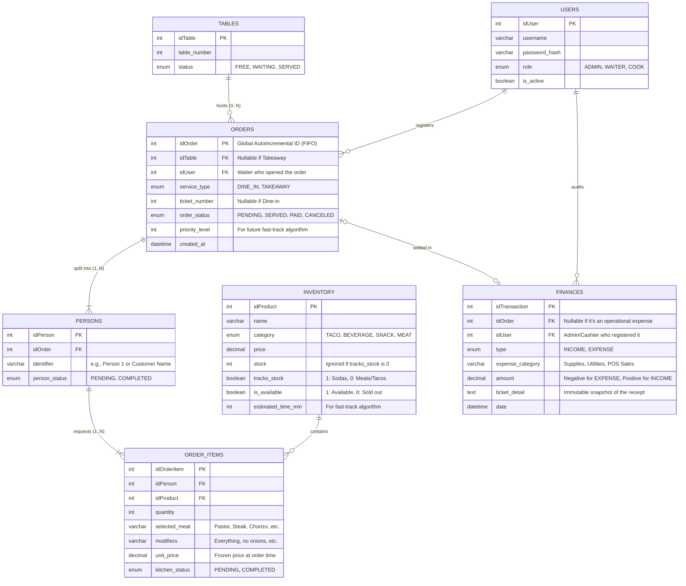
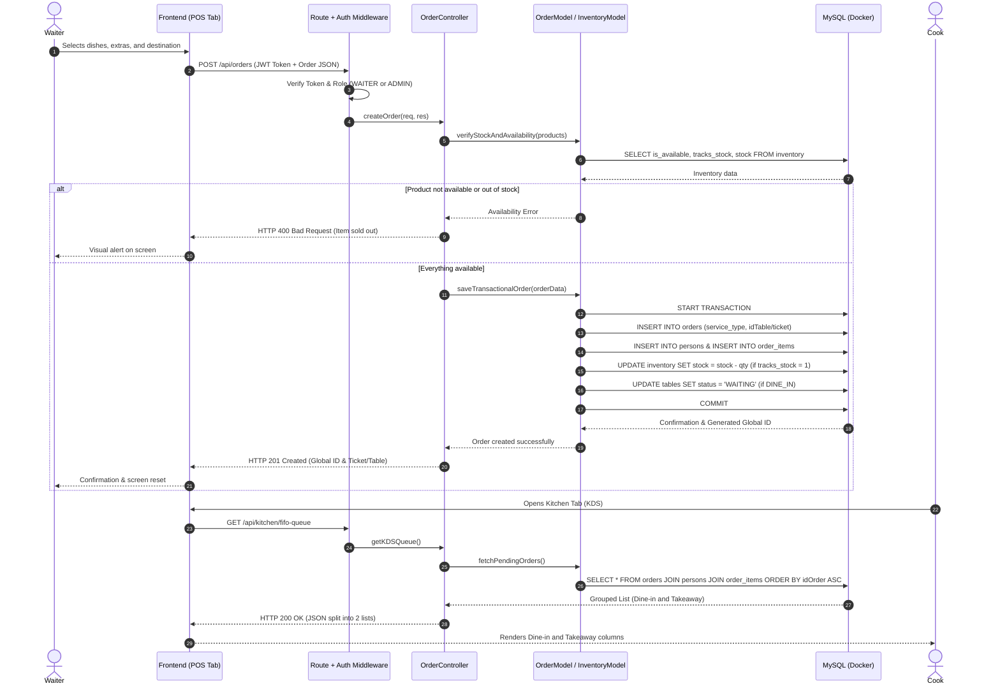
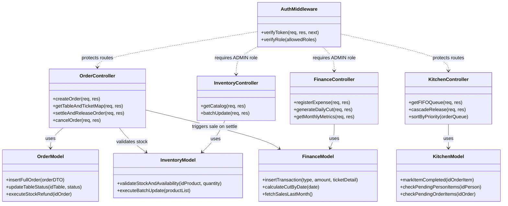

## Entity-Relationship (ER) Diagram

Database schema adapted to support "Takeaway" orders without a mandatory table assignment, featuring a global autoincremental ID for unified FIFO sorting.

---
## UML Sequence Diagram: Order Creation (MVC Flow)

---
## UML Class Diagram (MVC Pattern)

